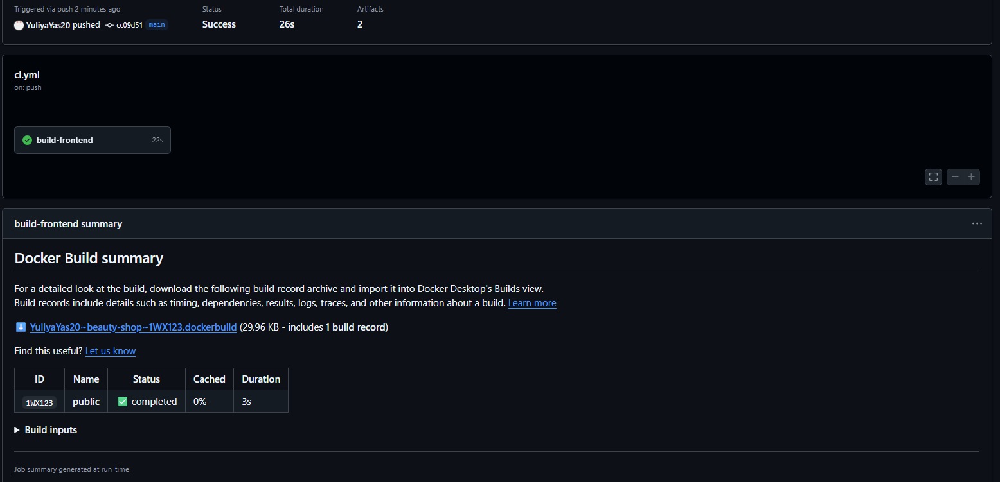

# Beauty Shop

Навчальний командний проєкт з дисципліни
«Web-дизайн та Web-програмування».

## Опис проєкту

Beauty Shop — вебзастосунок онлайн-магазину косметики,
який розробляється протягом семестру.

## Команда

- Ріта — бекенд, база даних, API.
- Юля — фронтенд, HTML, JavaScript.

## Технології

- Node.js
- Express
- SQLite
- HTML, CSS, JavaScript
- Git та GitHub

## Практична робота №1

Реалізовано:

- Сервер на Node.js та Express.
- Базу даних SQLite.
- Таблицю items (id, name).
- API GET /items для отримання товарів.

## Запуск проєкту

1. Встановити Node.js.
2. Відкрити термінал у папці проєкту.
3. Встановити залежності:

   npm install

4. Запустити сервер:

   node server.js

5. Відкрити в браузері:

   http://localhost:3000/items

База даних створюється автоматично під час запуску сервера.

## АРІ документація

Контракт REST API описано у форматі OpenAPI 3.0 та перевірено у Swagger Editor.

- **Специфікація OpenAPI:** [docs/api/openapi.yaml](docs/api/openapi.yaml)
- **Архітектурні рішення (ADR):**
  - [0001 — Вибір архітектурного стилю (Модульний моноліт)](docs/adr/0001-architecture-style.md)
  - [0002 — Шарова архітектура](docs/adr/0002-layered-architecture.md)
  - [0003 — Стиль REST API та модель помилок](docs/adr/0003-api-style-and-error-model.md)

### Попередній перегляд у Swagger Editor

## CI/CD (GitHub Actions)

Для автоматичної перевірки та збірки Docker-образу фронтенду налаштовано пайплайн у файлі `.github/workflows/ci.yml`. При кожному `push` або `pull_request` у гілку `main` (якщо змінювалися файли у `public/`) автоматично збирається образ `beauty-shop-web` та зберігається як артефакт `beauty-shop-web-image`.

## Практична робота №8 (Observability)

- **Звіт по роботі:** [docs/lab8-observability.md](docs/lab8-observability.md)
- **JSON-конфігурація дашборду:** [docs/my-demo-red-dashboard.json](docs/my-demo-red-dashboard.json)
