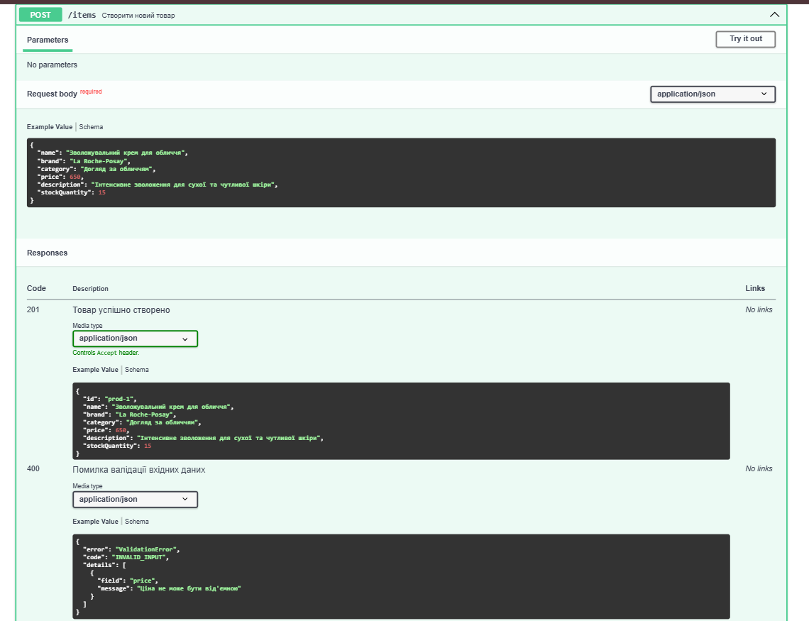
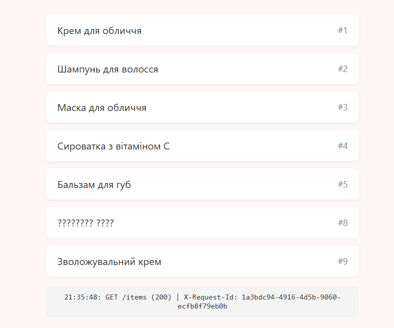

# Beauty Shop


Навчальний командний проєкт з дисципліни
«Web-дизайн та Web-програмування».

## Опис проєкту

Beauty Shop — вебзастосунок онлайн-магазину косметики,
який розробляється протягом семестру.

## Команда

- Ріта — бекенд, база даних, API.
- Юля — фронтенд, HTML, JavaScript.

## Технології

- Node.js
- Express
- SQLite
- HTML, CSS, JavaScript
- Git та GitHub

## Практична робота №1

Реалізовано:

- Сервер на Node.js та Express.
- Базу даних SQLite.
- Таблицю items (id, name).
- API GET /items для отримання товарів.

## Запуск проєкту

1. Встановити Node.js.
2. Відкрити термінал у папці проєкту.
3. Встановити залежності:

   npm install

4. Запустити сервер:

   node server.js

5. Відкрити в браузері:

   http://localhost:3000/items

База даних створюється автоматично під час запуску сервера.

## АРІ документація

Контракт REST API описано у форматі OpenAPI 3.0 та перевірено у Swagger Editor.

- **Специфікація OpenAPI:** [docs/api/openapi.yaml](docs/api/openapi.yaml)
- **Архітектурні рішення (ADR):**
  - [0001 — Вибір архітектурного стилю (Модульний моноліт)](docs/adr/0001-architecture-style.md)
  - [0002 — Шарова архітектура](docs/adr/0002-layered-architecture.md)
  - [0003 — Стиль REST API та модель помилок](docs/adr/0003-api-style-and-error-model.md)

### Попередній перегляд у Swagger Editor



## Практична робота №7. CI/CD (GitHub Actions)

### Мета роботи

Налаштувати автоматичне тестування проєкту Beauty Shop та збірку Docker-образу за допомогою GitHub Actions.

### 1. Налаштування CI/CD

Для автоматизації створено файл `.github/workflows/ci.yml`.

Пайплайн запускається під час `push` у гілку `main` та створення або оновлення Pull Request до `main`, якщо змінюються відповідні файли проєкту: `public/`, `tests/`, `package.json`, `package-lock.json` або конфігурація CI.

### 2. Автоматичне тестування

GitHub Actions виконує такі дії:

1. Завантажує код із GitHub.
2. Налаштовує Node.js 22 та кешування npm.
3. Встановлює залежності командою `npm ci`.
4. Запускає тести командою `npm test`.

У проєкті реалізовано три автоматичні тести:

- Перевірка структури товару.
- Отримання товару за ID.
- Перевірка помилки при створенні товару з від'ємною ціною.

Для послідовного виконання тестів використовується команда `node --test --test-concurrency=1`.

### 3. Автоматична збірка Docker-образу

Після успішного проходження тестів GitHub Actions збирає Docker-образ фронтенду на основі `public/Dockerfile`.

Створений образ зберігається у TAR-файлі та завантажується як артефакт `beauty-shop-web-image`.

### 4. Отримання Docker-образу

1. Відкрити вкладку [GitHub Actions](https://github.com/ritahvisuk-boop/beauty-shop/actions).
2. Вибрати успішний запуск `Frontend CI`.
3. У розділі **Artifacts** завантажити `beauty-shop-web-image`.
4. Розпакувати завантажений архів, щоб отримати TAR-файл Docker-образу.
5. Завантажити образ у Docker командою:

```bash
docker load -i beauty-shop-web.tar
```

### 5. Результати роботи

Автоматичне тестування та збірка Docker-образу успішно виконані.

- [GitHub Actions — результати CI/CD](https://github.com/ritahvisuk-boop/beauty-shop/actions/workflows/ci.yml)
- [Pull Request №15 — налаштування автоматичного тестування](https://github.com/ritahvisuk-boop/beauty-shop/pull/15)
- [Pull Request №16 — налаштування послідовного запуску тестів](https://github.com/ritahvisuk-boop/beauty-shop/pull/16)


### Висновок

Під час виконання практичної роботи налаштовано CI/CD для Beauty Shop за допомогою GitHub Actions. Реалізовано автоматичне тестування, збірку Docker-образу фронтенду та його збереження як артефакту. Це дозволяє перевіряти зміни в коді та отримувати готовий Docker-образ після успішного виконання пайплайна.

## Практична робота №6. Контейнеризація застосунку за допомогою Docker

### Мета роботи

Встановити Docker Desktop, перевірити його працездатність за допомогою офіційного образу `hello-world` та контейнеризувати вебзастосунок Beauty Shop.

### Використані технології

- Docker Desktop
- Docker Engine
- Node.js 22
- Express
- SQLite
- HTML, CSS, JavaScript

### 1. Перевірка Docker

Для перевірки встановлення Docker виконано команди:

```bash
docker version
docker run hello-world
```

У результаті отримано повідомлення `Hello from Docker!`, що підтверджує успішну роботу Docker.

### 2. Контейнеризація бекенду

У корені проєкту створено файли:

- `Dockerfile` — інструкції для створення Docker-образу Node.js-застосунку.
- `.dockerignore` — виключення непотрібних файлів під час збірки образу.

Для збірки Docker-образу бекенду використовується команда:

```bash
docker build -t beauty-shop-backend .
```

Для запуску контейнера:

```bash
docker run -d --name beauty-shop-container -p 8080:3000 beauty-shop-backend
```

Порт `3000` використовується сервером усередині контейнера, а порт `8080` — для доступу до застосунку з комп'ютера.

### 3. Перевірка роботи контейнера

Перегляд запущених контейнерів:

```bash
docker ps
```

Перегляд логів:

```bash
docker logs beauty-shop-container
```

Після запуску застосунок доступний за адресами:

- Головна сторінка: http://localhost:8080
- Перевірка стану API: http://localhost:8080/health
- Список товарів: http://localhost:8080/items

Ендпоінт `/health` повертає:

```json
{ "status": "ok" }
```

Ендпоінт `/items` повертає список товарів із бази даних SQLite.

Для зупинки контейнера:

```bash
docker stop beauty-shop-container
```

Для видалення зупиненого контейнера перед повторним запуском:

```bash
docker rm beauty-shop-container
```

### 4. Контейнеризація фронтенду

Для фронтенду Beauty Shop у папці `public/` підготовлено окремі файли:

- `public/Dockerfile`
- `public/.dockerignore`

Вони призначені для контейнеризації клієнтської частини застосунку.

### 5. Результат роботи

У ході практичної роботи встановлено та перевірено Docker Desktop, створено Docker-образ бекенду Beauty Shop і успішно запущено контейнер.

Перевірено доступність вебзастосунку та API через порт `8080`.

Скриншот роботи застосунку:



### Висновок

Під час виконання практичної роботи отримано навички роботи з Docker, створення Dockerfile та .dockerignore, збірки образів і запуску контейнерів. Контейнеризація дозволяє запускати застосунок в ізольованому середовищі з необхідними залежностями та спрощує його розгортання на інших комп'ютерах.

## Практична робота №9: Теоретична схема Kubernetes-додатку

- Документація та опис архітектури: [docs/lab9-kubernetes.md](docs/lab9-kubernetes.md)
- Архітектурна схема: [docs/lab9-kubernetes-beauty-shop.png](docs/lab9-kubernetes-beauty-shop.png) (вихідний файл: [docs/lab9-kubernetes-beauty-shop.drawio](docs/lab9-kubernetes-beauty-shop.drawio))
