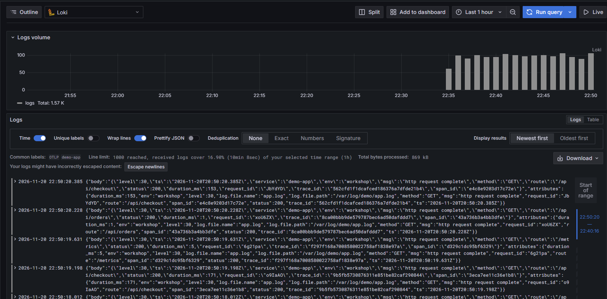

# Практична робота №8: Observability з Grafana, Loki, Tempo та OpenTelemetry

## 1. Базовий моніторинг стенду `observability-demo` (Рівень 60 балів)

### RED-дашборд сервісу `demo-app`

На графіках відображаються ключові RED-метрики сервісу `demo-app`: інтенсивність вхідних запитів за маршрутами (`/api/checkout`, `/api/orders`, `/metrics`), відсоток помилок 5xx (Error rate) та 95-й перцентиль затримки відповідей (Latency p95), згенеровані тестовим навантаженням.

### Розподілене трасування у Tempo

На скріншоті показано детальний trace виконання HTTP-запиту `GET /api/checkout?flow=payment-error` у сервісі `demo-app` із кодом відповіді `502`: видно часову шкалу та тривалість кожного вкладеного етапу (`checkout.flow`, запит до бази даних `db.query orders` та виклик платіжного шлюзу `http.call payment-gateway`).

### Перегляд логів у Loki

На скріншоті відображено потік структурованих JSON-логів сервісу `demo-app`, відфільтрованих за міткою `service="demo-app"`, де фіксуються метод, маршрут, статус відповіді, час виконання (`duration_ms`) та `trace_id` для зв'язку логів із трейсами.

---

## 2. Власний RED-дашборд `My Demo RED`
