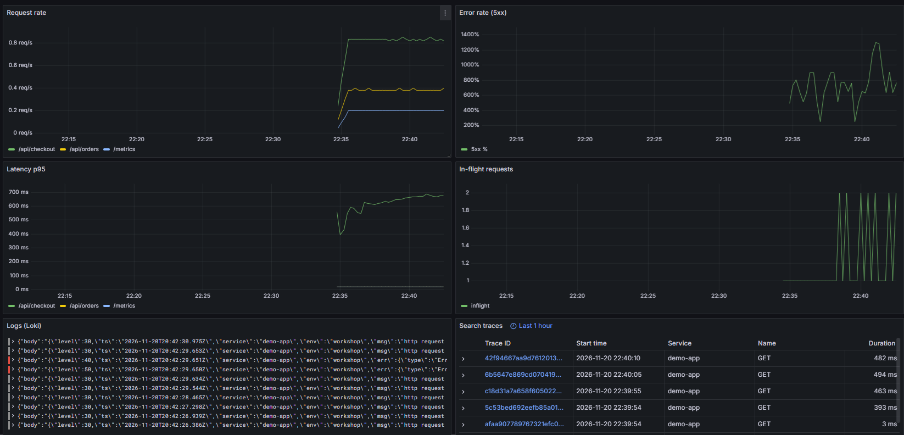
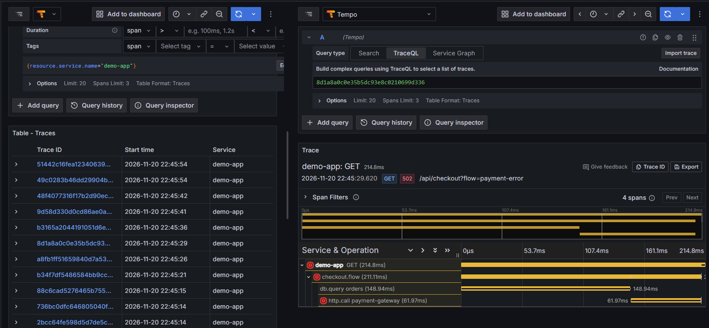
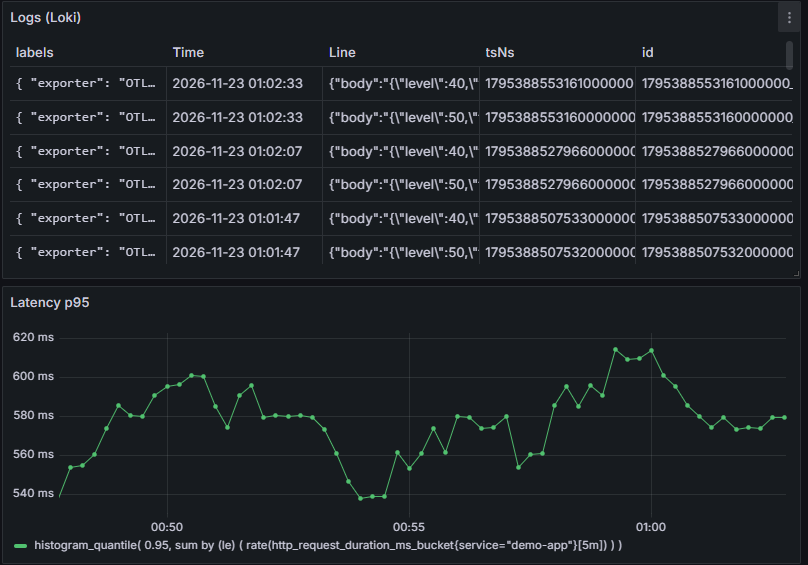
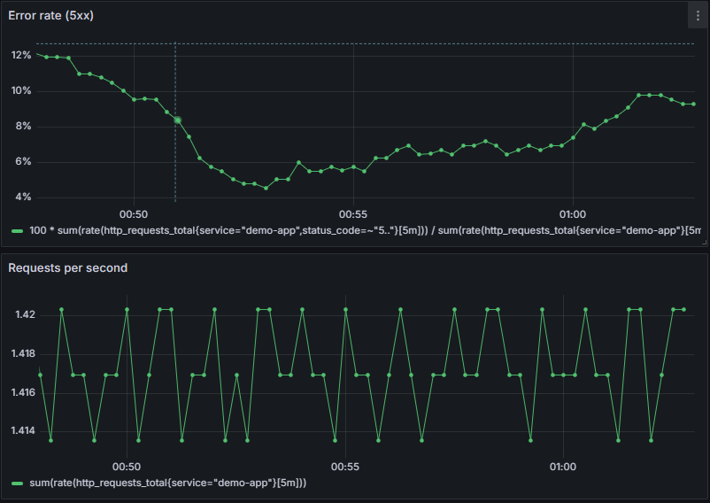

# Практична робота №8: Observability з Grafana, Loki, Tempo та OpenTelemetry

## 1. Базовий моніторинг стенду `observability-demo` (Рівень 60 балів)

### RED-дашборд сервісу `demo-app`

На графіках відображаються ключові RED-метрики сервісу `demo-app`: інтенсивність вхідних запитів за маршрутами (`/api/checkout`, `/api/orders`, `/metrics`), відсоток помилок 5xx (Error rate) та 95-й перцентиль затримки відповідей (Latency p95), згенеровані тестовим навантаженням.



### Розподілене трасування у Tempo

На скріншоті показано детальний trace виконання HTTP-запиту `GET /api/checkout?flow=payment-error` у сервісі `demo-app` із кодом відповіді `502`: видно часову шкалу та тривалість кожного вкладеного етапу (`checkout.flow`, запит до бази даних `db.query orders` та виклик платіжного шлюзу `http.call payment-gateway`).



### Перегляд логів у Loki

На скріншоті відображено потік структурованих JSON-логів сервісу `demo-app`, відфільтрованих за міткою `service="demo-app"`, де фіксуються метод, маршрут, статус відповіді, час виконання (`duration_ms`) та `trace_id` для зв'язку логів із трейсами.


---

## 2. Власний RED-дашборд `My Demo RED`
Для виконання практичної роботи було створено власний дашборд **My Demo RED** у Grafana на основі даних сервісу `demo-app`. Дашборд містить чотири панелі для моніторингу кількості запитів, помилок, затримки відповідей та логів.

### 2.1. Requests per second

**Джерело даних:** Prometheus.

```promql
sum(rate(http_requests_total{service="demo-app"}[5m]))
```

Панель показує кількість HTTP-запитів за секунду до сервісу `demo-app`. Під час перевірки значення становило приблизно 1,42 запиту/с.

У реальному застосунку цей графік допомагає відстежувати навантаження на сервер.

### 2.2. Error rate (5xx)

**Джерело даних:** Prometheus.

```promql
100 *
sum(rate(http_requests_total{service="demo-app",status_code=~"5.."}[5m]))
/
sum(rate(http_requests_total{service="demo-app"}[5m]))
```

Панель показує відсоток HTTP-запитів, які завершилися серверними помилками 5xx. Під час перевірки показник становив приблизно 6–12%.

У реальному застосунку ця метрика дозволяє вчасно виявляти проблеми в роботі сервера.

### 2.3. Latency p95

**Джерело даних:** Prometheus.

```promql
histogram_quantile(
  0.95,
  sum by (le) (
    rate(http_request_duration_ms_bucket{service="demo-app"}[5m])
  )
)
```

Панель відображає 95-й перцентиль часу виконання HTTP-запитів у мілісекундах. Під час перевірки затримка становила приблизно 400–600 мс.

У реальному застосунку ця метрика допомагає виявляти уповільнення роботи сервісу.

### 2.4. Logs (Loki)

**Джерело даних:** Loki.

```logql
{service="demo-app"} |= "error"
```

Панель типу Table показує записи логів сервісу `demo-app`, що містять слово `error`.

У реальному застосунку логи допомагають знаходити причини помилок і аналізувати проблемні запити.

### 2.5. Перевірка роботи дашборду

Усі чотири панелі успішно відображають дані. Для перевірки використовувався часовий період Last 15 minutes. Панелі використовують спільний часовий діапазон дашборду.

**Скриншоти власного дашборду My Demo RED:**





**Експортований JSON-файл:**

[my-demo-red-dashboard.json](my-demo-red-dashboard.json)

### Висновок

Під час виконання практичної роботи було досліджено інструменти Grafana, Prometheus, Loki та Tempo. Створено власний дашборд My Demo RED із чотирма панелями для моніторингу сервісу `demo-app`. Отримано навички роботи з PromQL, LogQL, аналізу HTTP-запитів, серверних помилок, затримок і логів. Такий моніторинг дозволяє контролювати стан сервісу та швидко виявляти проблеми.