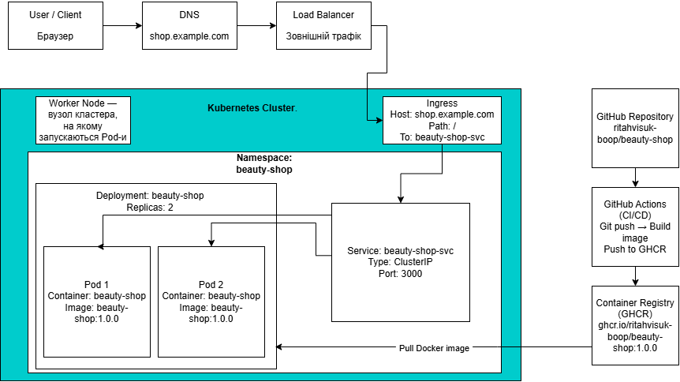

# Практична робота №9: Теоретична схема Kubernetes-додатку (Beauty Shop)

## 1. Опис сервісу

**Beauty Shop** — це вебзастосунок (REST API та клієнтська частина) для онлайн-магазину косметики, який дозволяє користувачам переглядати каталог товарів, додавати позиції до кошика та оформлювати замовлення. Основними користувачами системи є покупці магазину та адміністратори, які керують асортиментом продукції.

## 2. Архітектурна схема

_Вихідний файл діаграми: [lab9-kubernetes-beauty-shop.drawio](./lab9-kubernetes-beauty-shop.drawio)_

## 3. Опис архітектури Kubernetes та CI/CD

1. **Середовище розгортання:** Вебзастосунок Beauty Shop працює всередині ізольованого **Namespace** (`beauty-shop`) у межах кластера Kubernetes на Worker Node.
2. **Маршрутизація трафіку:** Запити від клієнта через DNS і зовнішній Load Balancer потрапляють на **Ingress**, який маршрутизує їх на внутрішній **Service** (ClusterIP), а той розподіляє навантаження між репліками сервісу.
3. **Відмовостійкість та масштабування:** Керування контейнерами здійснює **Deployment**, який підтримує **2 Pod-и** з образом застосунку (`beauty-shop`) — це забезпечує базову відмовостійкість і безперервну обробку запитів.
4. **CI/CD та постачання образу:** Після `git push` у репозиторій **GitHub** пайплайн **GitHub Actions** автоматично збирає Docker-образ і завантажує його в **Container Registry**, звідки Pod-и завантажують актуальну версію образу під час старту.
